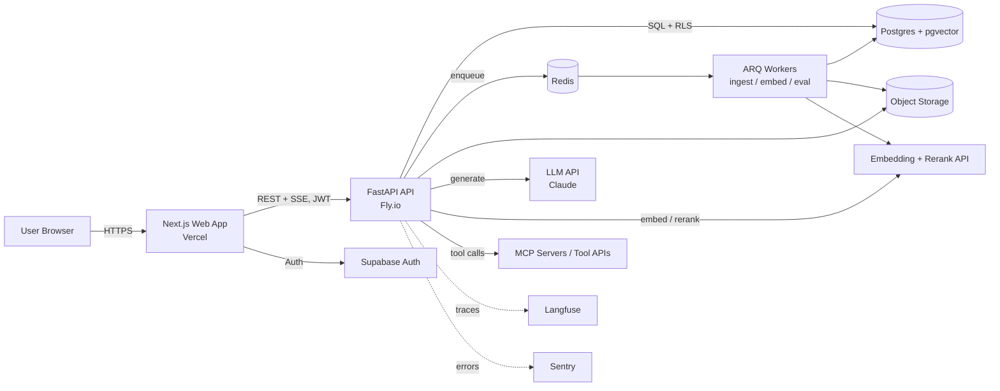
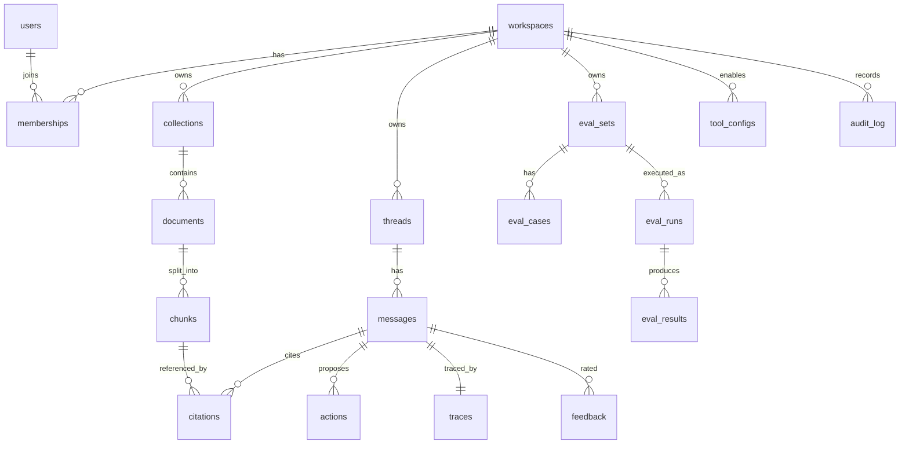

# DocPilot — Application Architecture

Based on `PRD.md` and `Techstack.md`.

---

## 1. System Overview



**Components**
- **Web (Next.js):** UI, session handling, streaming chat renderer, upload via signed URL.
- **API (FastAPI):** auth guard, retrieval, generation, agent loop, guardrails, rate limiting, tracing.
- **Workers (ARQ):** document parsing, chunking, embedding, eval runs, cleanup jobs.
- **Postgres:** system of record + vector index + keyword index + RLS.
- **Redis:** queue, rate limit counters, short-lived cache, idempotency keys.
- **External:** LLM, embeddings/reranker, MCP tools, observability.

---

## 2. Project Structure (monorepo)

```
docpilot/
├── apps/
│   ├── web/                          # Next.js frontend
│   │   ├── app/
│   │   │   ├── (marketing)/page.tsx          # landing (parallax, 3D hero)
│   │   │   ├── (auth)/login/ signup/
│   │   │   ├── (app)/
│   │   │   │   ├── layout.tsx                # shell: sidebar, auth gate
│   │   │   │   ├── chat/[threadId]/page.tsx
│   │   │   │   ├── documents/page.tsx
│   │   │   │   ├── collections/[id]/page.tsx
│   │   │   │   ├── actions/page.tsx          # agent action history
│   │   │   │   ├── evals/page.tsx            # golden sets, runs
│   │   │   │   └── monitoring/page.tsx       # latency, cost, feedback
│   │   │   └── api/                          # thin route handlers (cookies, health)
│   │   ├── components/
│   │   │   ├── chat/ (MessageList, Composer, CitationChip, ActionCard)
│   │   │   ├── documents/ (Uploader, StatusPill)
│   │   │   ├── motion/ (Reveal, Parallax, Tilt3D, Loader)
│   │   │   └── ui/                           # shadcn components
│   │   ├── lib/ (api-client.ts, sse.ts, supabase.ts, utils.ts)
│   │   ├── hooks/ (useChatStream, useUpload, useReducedMotion)
│   │   ├── styles/ (tokens.css, globals.css)
│   │   └── tests/ (unit, e2e/playwright)
│   │
│   └── api/                          # FastAPI backend
│       ├── app/
│       │   ├── main.py                       # app factory, middleware
│       │   ├── core/ (config.py, security.py, rate_limit.py, logging.py)
│       │   ├── api/v1/
│       │   │   ├── documents.py  collections.py  chat.py
│       │   │   ├── actions.py    evals.py        feedback.py
│       │   │   ├── analytics.py  workspaces.py   health.py
│       │   ├── services/
│       │   │   ├── ingestion/ (parse.py, chunk.py, embed.py, pipeline.py)
│       │   │   ├── retrieval/ (hybrid.py, rerank.py, rewrite.py)
│       │   │   ├── generation/ (prompts.py, answer.py, citations.py)
│       │   │   ├── agent/ (loop.py, tools/, mcp_client.py, policies.py)
│       │   │   ├── guardrails/ (injection.py, pii.py, output_check.py)
│       │   │   └── evals/ (runner.py, metrics.py, datasets.py)
│       │   ├── models/ (SQLAlchemy)   schemas/ (Pydantic)
│       │   ├── db/ (session.py, rls.sql, migrations/ via Alembic)
│       │   ├── workers/ (settings.py, tasks.py)
│       │   └── providers/ (llm.py, embeddings.py)   # swappable interfaces
│       ├── tests/ (unit, integration, evals/golden/*.jsonl, security/)
│       └── Dockerfile
│
├── packages/
│   └── api-types/                    # generated TS client from OpenAPI
├── infra/ (fly.toml, docker-compose.yml, terraform/)
├── docs/ (PRD.md, Techstack.md, Architecture.md, UI-UX.md)
└── .github/workflows/ (ci.yml, evals.yml, deploy.yml)
```

---

## 3. Frontend ↔ Backend Flow

### 3.1 Upload & ingest
1. UI requests `POST /v1/documents/upload-url` (name, size, type).
2. API validates quota/type, creates `documents` row (`status=queued`), returns **signed upload URL**.
3. Browser uploads directly to object storage (API never proxies large files).
4. UI calls `POST /v1/documents/{id}/complete` → API enqueues `ingest_document` job (idempotent).
5. Worker: verify magic bytes → parse → chunk → embed → insert chunks → `status=ready`.
6. UI subscribes (Supabase Realtime / polling `GET /v1/documents/{id}`) → status pill animates to **Ready**.

### 3.2 Chat (RAG + optional agent)
1. UI posts `POST /v1/chat/threads/{id}/messages` with `{content, collection_ids}`; opens SSE stream.
2. API: auth → rate limit → input guardrails → create `messages` + `traces` rows.
3. Rewrite follow-up into standalone query → hybrid retrieval → rerank.
4. If top score < threshold → stream "not found" response.
5. Else build prompt (system + chunks wrapped as **untrusted data** + history) → stream Claude tokens.
6. If model emits `tool_use` → agent policy check → **create pending action** → stream `action_proposed` event (no execution yet).
7. Post-process: validate citations ⊆ retrieved chunk IDs; strip invalid; run output guardrails.
8. Stream `done` event with citations, usage, trace ID; persist everything.

### 3.3 Action confirmation
1. User clicks Confirm/Edit/Reject on ActionCard.
2. `POST /v1/actions/{id}/confirm` with `Idempotency-Key`.
3. API re-validates permissions and params → executes tool (native or MCP) → stores result → returns status.
4. UI shows success/failure micro-interaction; audit row written.

### SSE event types
`token`, `citation`, `action_proposed`, `status` (e.g., "Searching documents…"), `error`, `done`.

---

## 4. Database Structure (PostgreSQL)



### Core tables (abridged DDL)

```sql
create extension if not exists vector;

create table workspaces (
  id uuid primary key default gen_random_uuid(),
  name text not null,
  created_at timestamptz default now()
);

create table memberships (
  workspace_id uuid references workspaces on delete cascade,
  user_id uuid references auth.users on delete cascade,
  role text check (role in ('owner','member','viewer')) not null,
  primary key (workspace_id, user_id)
);

create table collections (
  id uuid primary key default gen_random_uuid(),
  workspace_id uuid not null references workspaces on delete cascade,
  name text not null
);

create table documents (
  id uuid primary key default gen_random_uuid(),
  workspace_id uuid not null references workspaces on delete cascade,
  collection_id uuid references collections on delete set null,
  filename text not null,
  storage_path text not null,
  content_hash text not null,
  status text check (status in ('queued','parsing','embedding','ready','failed')),
  error text,
  page_count int,
  version int default 1,
  created_by uuid references auth.users,
  created_at timestamptz default now(),
  unique (workspace_id, content_hash)
);

create table chunks (
  id uuid primary key default gen_random_uuid(),
  workspace_id uuid not null,              -- denormalized for RLS + filtering
  document_id uuid not null references documents on delete cascade,
  ordinal int not null,
  page int,
  heading text,
  content text not null,
  tokens int,
  embedding vector(1024),
  tsv tsvector generated always as (to_tsvector('english', content)) stored
);
create index on chunks using hnsw (embedding vector_cosine_ops);
create index on chunks using gin (tsv);
create index on chunks (workspace_id, document_id);

create table threads (
  id uuid primary key default gen_random_uuid(),
  workspace_id uuid not null,
  user_id uuid not null,
  title text,
  created_at timestamptz default now()
);

create table messages (
  id uuid primary key default gen_random_uuid(),
  thread_id uuid references threads on delete cascade,
  role text check (role in ('user','assistant','tool')),
  content text,
  model text, input_tokens int, output_tokens int, cost_usd numeric(10,6),
  latency_ms int, ttft_ms int,
  created_at timestamptz default now()
);

create table citations (
  message_id uuid references messages on delete cascade,
  chunk_id uuid references chunks on delete set null,
  marker int, quote text,
  primary key (message_id, marker)
);

create table actions (
  id uuid primary key default gen_random_uuid(),
  workspace_id uuid not null,
  message_id uuid references messages,
  tool text not null,
  params jsonb not null,
  status text check (status in ('proposed','confirmed','rejected','succeeded','failed')),
  result jsonb,
  idempotency_key text unique,
  confirmed_by uuid, created_at timestamptz default now()
);

create table traces (
  message_id uuid primary key references messages on delete cascade,
  retrieved jsonb,          -- chunk ids + scores
  prompt_hash text,
  steps jsonb,              -- timings per stage, tool calls
  guardrail_flags jsonb
);

create table feedback (
  id uuid primary key default gen_random_uuid(),
  message_id uuid references messages on delete cascade,
  user_id uuid, rating smallint check (rating in (-1,1)), reason text
);

create table eval_sets   (id uuid primary key default gen_random_uuid(), workspace_id uuid, name text);
create table eval_cases  (id uuid primary key default gen_random_uuid(), eval_set_id uuid references eval_sets on delete cascade, question text, reference_answer text, reference_chunk_ids uuid[]);
create table eval_runs   (id uuid primary key default gen_random_uuid(), eval_set_id uuid references eval_sets, config jsonb, started_at timestamptz, finished_at timestamptz, summary jsonb);
create table eval_results(run_id uuid references eval_runs on delete cascade, case_id uuid references eval_cases, answer text, faithfulness real, relevance real, ctx_precision real, ctx_recall real, citation_valid bool);

create table tool_configs(workspace_id uuid, tool text, enabled bool default false, scopes jsonb, primary key(workspace_id, tool));
create table audit_log   (id bigserial primary key, workspace_id uuid, actor uuid, event text, meta jsonb, at timestamptz default now());
```

### Row-Level Security (pattern applied to every tenant table)

```sql
alter table chunks enable row level security;
create policy tenant_isolation on chunks
  using (workspace_id in (
    select workspace_id from memberships where user_id = auth.uid()));
-- Writes additionally require role in ('owner','member').
```
API connects with a restricted role and sets `request.jwt.claims` per request so RLS applies even to API-originated queries. Workers use a separate service role, scoped to explicit `workspace_id` in every query.

### Hybrid retrieval query (sketch)
```sql
with v as (
  select id, row_number() over (order by embedding <=> :q_emb) r
  from chunks where workspace_id = :ws and document_id = any(:doc_ids)
  order by embedding <=> :q_emb limit 40),
k as (
  select id, row_number() over (order by ts_rank_cd(tsv, plainto_tsquery(:q)) desc) r
  from chunks where workspace_id = :ws and document_id = any(:doc_ids)
    and tsv @@ plainto_tsquery(:q) limit 40)
select coalesce(v.id,k.id) id,
       coalesce(1.0/(60+v.r),0)+coalesce(1.0/(60+k.r),0) score
from v full join k on v.id=k.id
order by score desc limit 20;   -- then rerank → top 6
```

---

## 5. API Structure (`/v1`, JSON, JWT bearer)

| Area | Method & Path | Purpose |
|---|---|---|
| Health | `GET /health` | Liveness/readiness |
| Workspaces | `GET /workspaces/me` · `POST /workspaces/{id}/members` | Membership & roles |
| Collections | `GET/POST /collections` · `PATCH/DELETE /collections/{id}` | Organize docs |
| Documents | `POST /documents/upload-url` · `POST /documents/{id}/complete` · `GET /documents` · `GET /documents/{id}` · `DELETE /documents/{id}` · `POST /documents/{id}/reindex` | Lifecycle |
| Chunks | `GET /chunks/{id}` | Citation preview (text, page, doc) |
| Chat | `POST /chat/threads` · `GET /chat/threads` · `GET /chat/threads/{id}` · `POST /chat/threads/{id}/messages` *(SSE)* · `DELETE /chat/threads/{id}` | Conversations |
| Feedback | `POST /messages/{id}/feedback` | Thumbs + reason |
| Actions | `GET /actions` · `POST /actions/{id}/confirm` · `POST /actions/{id}/reject` · `PATCH /actions/{id}` (edit params) | Agent human-in-loop |
| Tools | `GET/PUT /tools` · `POST /tools/mcp` (register MCP server) | Tool permissions |
| Evals | `GET/POST /eval-sets` · `POST /eval-sets/{id}/cases` · `POST /eval-sets/{id}/runs` · `GET /eval-runs/{id}` | Quality checks |
| Analytics | `GET /analytics/usage?from&to` · `GET /analytics/quality` · `GET /traces/{message_id}` | Monitoring |
| Privacy | `POST /me/export` · `DELETE /me` | Data rights |

**Conventions:** cursor pagination; RFC 7807 problem responses; `Idempotency-Key` on POST that mutate/execute; `202` + job ID for long tasks; rate-limit headers (`X-RateLimit-*`); OpenAPI is the contract.

**Example SSE response**
```
event: status   data: {"stage":"retrieving"}
event: token    data: {"text":"Notice period is 60 days"}
event: citation data: {"marker":1,"chunk_id":"…","doc":"Vendor_Contract.pdf","page":7}
event: action_proposed data: {"action_id":"…","tool":"create_task","params":{…}}
event: done     data: {"message_id":"…","usage":{"in":2840,"out":210},"trace_id":"…"}
```

---

## 6. Authentication & Authorization Flow

```mermaid
sequenceDiagram
    participant B as Browser
    participant N as Next.js
    participant SA as Supabase Auth
    participant API as FastAPI
    participant DB as Postgres (RLS)
    B->>N: Sign in (email/Google)
    N->>SA: Authenticate (+MFA if enabled)
    SA-->>N: Access JWT (15 min) + Refresh token
    N-->>B: Set httpOnly, Secure, SameSite=Lax cookies
    B->>N: Navigate (cookie)
    N->>API: Request + Authorization: Bearer JWT
    API->>API: Verify signature (JWKS), exp, aud
    API->>DB: Load membership/role for workspace
    API->>DB: Query with claims set → RLS enforces tenant
    DB-->>API: Rows
    API-->>N: Response
    Note over N,SA: Silent refresh before expiry; refresh rotation + reuse detection
```

**Rules**
- Authorization is checked in **three layers:** route dependency (role), service logic (resource ownership), database (RLS).
- Viewer: read/chat only. Member: upload, chat, confirm own actions. Owner: members, tools, deletion.
- Sensitive actions (delete workspace, enable tool) require recent re-authentication.
- Rate limit by IP before auth and by user/workspace after.

---

## 7. Data Flow

### 7.1 Ingestion data flow
```
File → Object storage → Worker
  → type/magic-byte check → malware scan hook
  → parse (PyMuPDF / python-docx; OCR fallback)
  → clean (strip headers/footers, normalize)
  → chunk (≈500 tokens, 80 overlap, heading-aware; keep page + heading metadata)
  → embed (batched) → insert chunks + tsvector
  → document.status = ready → audit_log
```

### 7.2 Query data flow
```
User question
 → input guardrails (length, injection heuristics, PII flag)
 → query rewrite (history → standalone)
 → hybrid retrieve (vector + keyword, workspace/collection filtered)
 → rerank → top 6 → confidence check
 → prompt assembly (trusted system / untrusted context fenced)
 → LLM stream (+ tool_use?) 
 → citation validation → output guardrails
 → persist message, citations, trace, cost
 → SSE to client → feedback → eval dataset candidates
```

### 7.3 Evaluation data flow
```
Golden set (or promoted thumbs-down cases)
 → worker replays each question through the SAME pipeline (pinned config)
 → metrics: faithfulness, relevance, ctx precision/recall, citation validity
 → eval_results + run summary
 → CI compares to baseline → fail build on regression
 → dashboard trends per config version
```

### 7.4 Observability data flow
Every request emits an OpenTelemetry trace → Langfuse (LLM spans: prompt hash, tokens, cost) and Sentry (errors). Aggregates are written to `messages`/`traces` for the in-app dashboard.

---

## 8. Agent Design Notes

- **Loop:** model proposes a tool call → policy engine validates (tool enabled? scope? params schema? triggered by user intent rather than document text?) → pending action created → user confirms → executor runs → result fed back (max 5 steps, token/cost budget per run).
- **Tool registry:** each tool has JSON schema, risk level (`read` / `write` / `external-send`), required role, and idempotency strategy. Only `read` tools may auto-run; others always need confirmation in MVP.
- **MCP:** MCP servers registered per workspace with allowlisted tool names; credentials stored encrypted; calls proxied through API (browser never talks to MCP directly).
- **Untrusted content rule:** text from documents is quoted data. A tool call whose parameters appear to originate from retrieved text rather than the user's request is flagged and requires explicit user edit.

---

## 9. Security Risks & Mitigations

| # | Risk | Severity | Mitigation |
|---|---|---|---|
| S1 | **Cross-tenant data leak** (bug in query filter) | Critical | RLS on all tables; workspace_id in every chunk; automated isolation tests in CI; vector queries always filtered pre-search |
| S2 | **Prompt injection via documents** (indirect) | Critical | Fence retrieved text as data; instruction hierarchy in system prompt; injection scanner on chunks at ingest; tool calls need confirmation; block tool params derived solely from retrieved content |
| S3 | **Unsafe agent actions** (exfiltration, spam emails) | High | Human confirmation; per-tool scopes; recipient allowlists/domain checks; daily action caps; idempotency keys; audit log |
| S4 | **Malicious file upload** (malware, zip bomb, parser exploits) | High | Magic-byte validation; size/page caps; sandboxed worker container with no network except storage; timeouts; dependency updates |
| S5 | **Sensitive data in logs/traces** | High | PII redaction before Langfuse; configurable trace retention; encrypt at rest; role-gated trace viewer |
| S6 | **Broken auth/session** | High | Short-lived JWTs, refresh rotation, httpOnly cookies, MFA, strict CORS, CSRF protections |
| S7 | **Secrets leakage** (LLM keys) | High | Secrets only server-side; secret scanning in CI; key rotation; per-env keys with spend limits |
| S8 | **Cost/denial-of-wallet attacks** | Medium | Per-user rate limits, token budgets, max context size, cancel on disconnect, anomaly alerts |
| S9 | **SSRF via URL ingestion / MCP** | Medium | Allowlist egress, block private IP ranges, DNS rebinding checks, timeouts |
| S10 | **XSS from rendered markdown/citations** | Medium | Sanitize markdown (rehype-sanitize), strict CSP, no `dangerouslySetInnerHTML` on model output |
| S11 | **Hallucinated/forged citations** | Medium | Server-side citation validation against retrieved set; display exact quote |
| S12 | **Insecure dependencies** | Medium | Dependabot, `pip-audit`/`npm audit`, Trivy, pinned lockfiles, SBOM |
| S13 | **Incomplete deletion** | Medium | Cascade deletes across chunks, storage, traces; deletion job with verification; backups retention documented |

## 10. Performance Risks & Mitigations

| # | Risk | Impact | Mitigation |
|---|---|---|---|
| P1 | Slow time-to-first-token | Poor UX | Stream immediately with `status` events; run rewrite + retrieval in parallel where possible; use small model for rewrite; prompt caching for system prompt |
| P2 | Vector search slows with growth | Latency | HNSW tuning (`ef_search`), filter by workspace, partition by workspace at scale, monitor p95 retrieval; migrate to dedicated vector DB only on trigger |
| P3 | Reranker adds latency | +100–300 ms | Rerank only top 20; skip rerank on high-confidence fusion scores; regional endpoints |
| P4 | Ingestion backlog (large PDFs) | Slow readiness | Dedicated worker pool, batch embeddings, per-page progress, autoscale on queue depth, cap per-workspace concurrency |
| P5 | Context bloat → cost + lost-in-middle | Quality/cost | Top 5–8 chunks, dedupe overlap, trim history with summarization, enforce token ceiling |
| P6 | LLM provider rate limit/outage | Errors | Backoff + jitter, circuit breaker, fallback model, queue-friendly UX messages |
| P7 | N+1 queries / unindexed filters | API latency | Index on `(workspace_id, …)`, eager loading, query plans reviewed with `EXPLAIN` |
| P8 | Heavy frontend (3D, parallax, large chat) | Jank, poor Core Web Vitals | Lazy-load 3D/R3F only on landing; virtualize long message lists; animate `transform/opacity` only; LCP budget < 2.5 s; respect reduced motion |
| P9 | SSE connection limits/proxy buffering | Stalled streams | Disable proxy buffering, heartbeat events, auto-reconnect with `Last-Event-ID` |
| P10 | Eval runs compete with live traffic | Chat slowdowns | Run in worker queue with concurrency cap; separate LLM key/quota |
| P11 | Duplicate/repeated questions waste cost | Cost | Semantic cache (v1.2), exact-match cache on (workspace, query, doc version) |
| P12 | Embedding model change requires reindex | Downtime/cost | Store `embedding_model` + version; dual-write migration; background re-embed |

---

## 11. Environments & Operations

- **Environments:** local (docker-compose: Postgres+pgvector, Redis, MinIO) → preview (per PR) → staging → production.
- **Migrations:** Alembic, backward-compatible (expand → migrate → contract).
- **Backups & DR:** daily snapshots + PITR; restore drill each quarter.
- **Alerts:** error rate > 2%, TTFT p95 > 3 s, queue depth > threshold, daily LLM spend > budget, eval score drop, auth failure spikes.
- **Runbooks:** provider outage, ingestion stuck, suspected data leak, key compromise.
